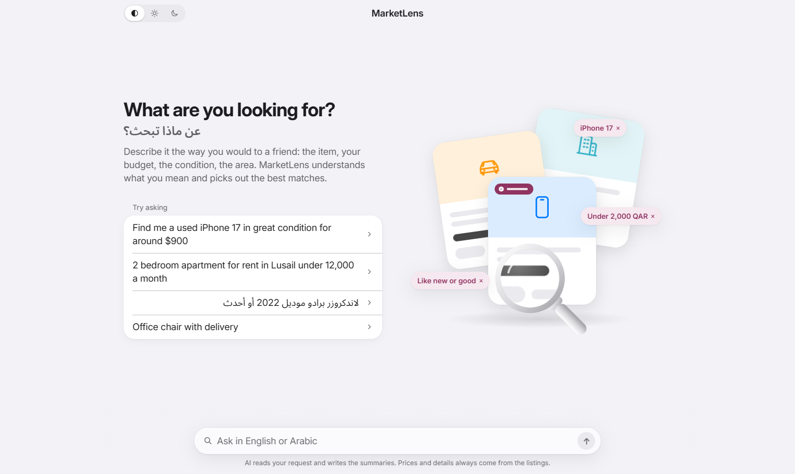
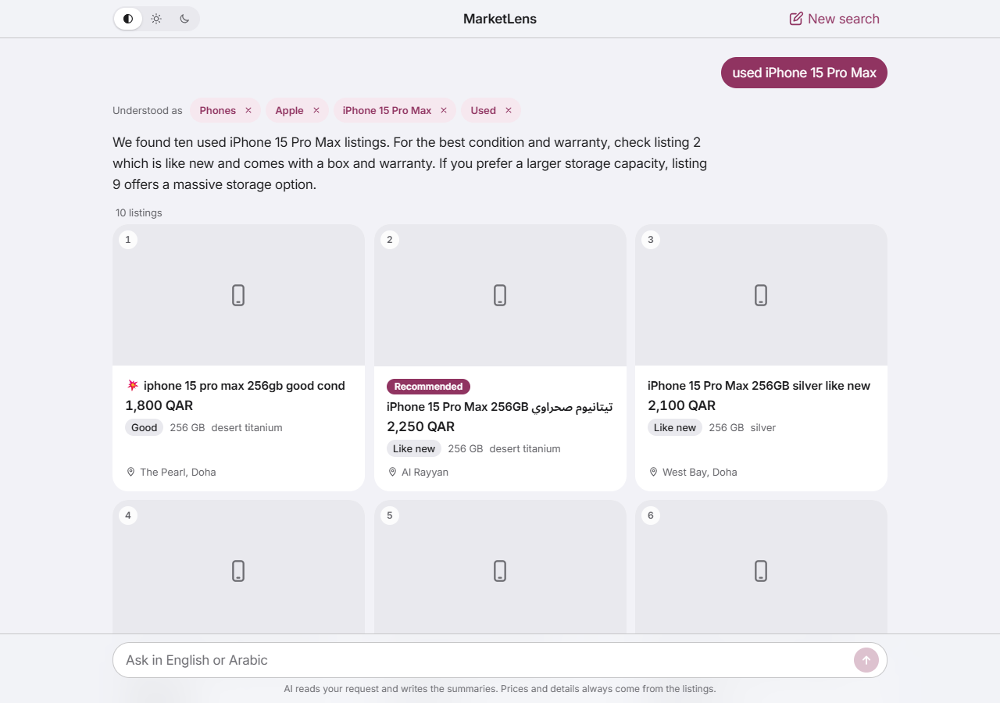
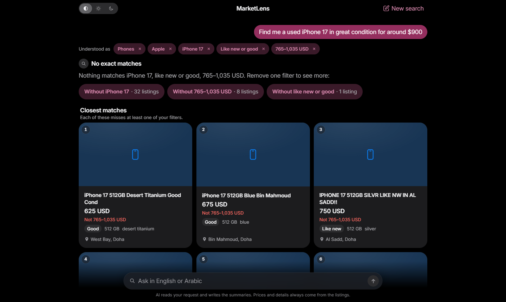
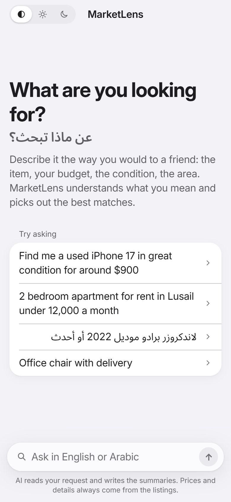
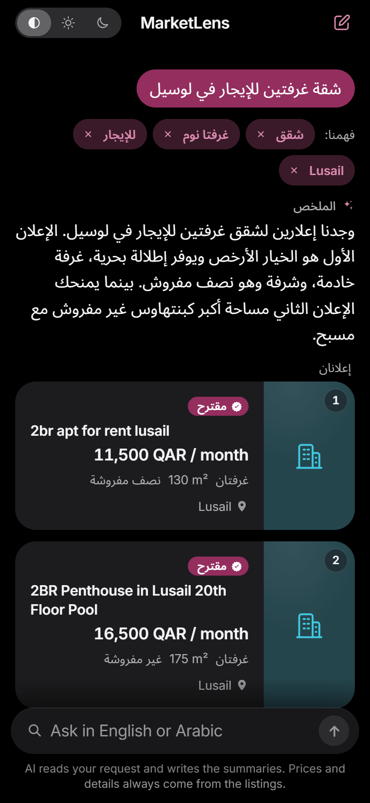
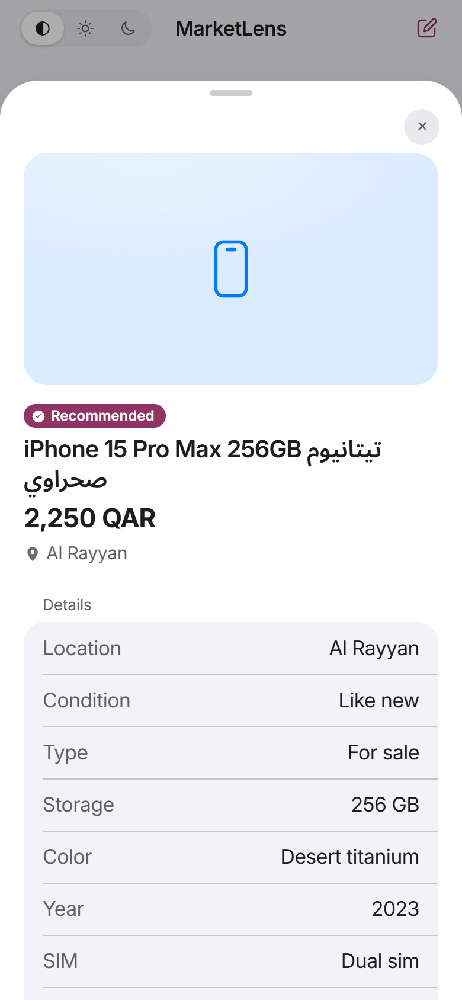
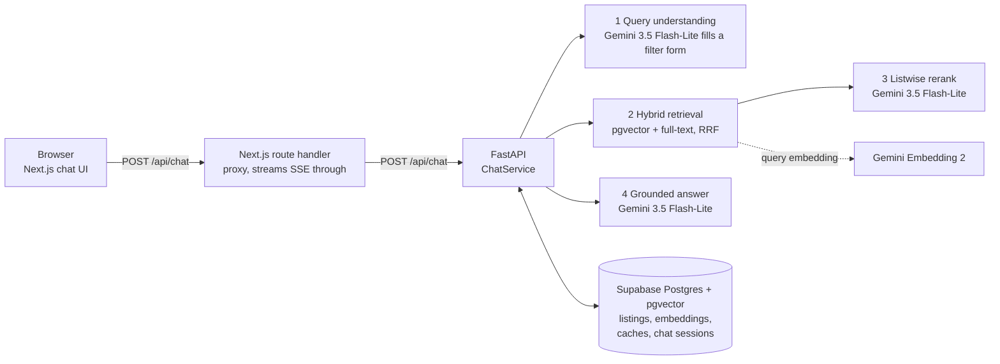
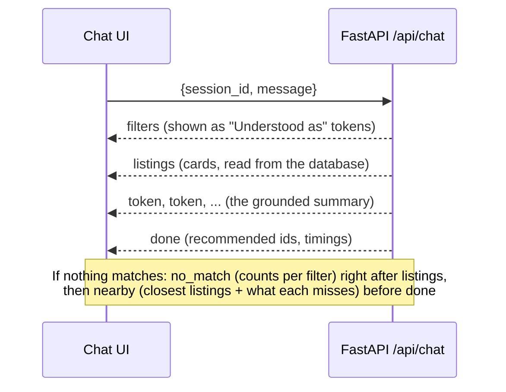

# MarketLens

**An AI search assistant for a marketplaces in Qatar.** Search a marketplace the way you'd ask a friend, and MarketLens turns it into an exact search, finds the listings that match, and explains the best picks.

<p align="center">
  
</p>

Describe what you want in plain English or Arabic. Type *"Find me a used iPhone 17 in great condition for around 3000 QR"* (or the same in any Arabic dialect), and MarketLens works out what you mean, finds the listings that really match, and explains its picks. Every price and detail on screen comes straight from the database, never from the AI.


Under the hood it is a full retrieval-augmented generation (RAG) system built from scratch: LLM query understanding, hybrid search (pgvector + Postgres full-text, fused with RRF), LLM reranking, grounded answers streamed over server-sent events, multi-turn conversation memory, and an evaluation harness that measured every step. The listings are 2,205 synthetic marketplace ads for Qatar, in English, Arabic and mixed text.

<p align="center">
  
</p>

| | Plain vector search (baseline) | MarketLens |
|---|---|---|
| Relevant listings found in the top 10 (Recall@10) | 0.853 | **1.000** |
| First result relevant (MRR) | 0.919 | **1.000** |
| Results that break something the user asked for | 31% | **0%** |
| Multi-turn conversations passed | – | **12 / 12** |
| Replies containing an invented price, link or listing | – | **0 / 45** |

Measured on a frozen set of 45 queries written before any improvement ([docs/results.md](docs/results.md)).

---

## Contents

- [What it does](#what-it-does)
- [Architecture](#architecture)
- [How a search works](#how-a-search-works)
- [How the chat works](#how-the-chat-works)
- [The listings data](#the-listings-data)
- [Evaluation](#evaluation)
- [Getting started](#getting-started)
- [API](#api)
- [Project layout](#project-layout)
- [Tests and checks](#tests-and-checks)
- [Limitations and next steps](#limitations-and-next-steps)

## What it does

- **Understands messy, bilingual requests.** "used", "بحالة ممتازة" (in excellent condition), "around $900", "2BR for rent in Lusail under 12k a month" all become exact filters: category, brand, model, condition, price range and currency, sale or rent, location, and attributes such as bedrooms, mileage or storage.
- **Shows what it understood.** The filters appear as removable tokens under your message ("Understood as: iPhone 17 × · Like new or good × · 765–1,035 USD ×"). Remove one and the search re-runs with exactly what's left, with no AI call.
- **Returns listings that actually match.** Hard constraints are SQL filters, so a "under 2,000 QAR" search never shows a 2,100 QAR phone. Within the matches, hybrid search and an LLM reranker decide the order.
- **Explains, without making things up.** A short summary points out the best options. The model never sees exact prices and isn't allowed to write any. Every card is re-read from the database.
- **Remembers the conversation.** "under 2000 riyals", "what about Samsung?", "cheaper ones" or "start over" refine the previous search.
- **Never leaves you at a dead end.** When nothing matches, it says which single filter to drop and how many listings that would bring back ("Without 765–1,035 USD · 8 listings"). Below that it shows the **closest matches**, each labelled with what it misses ("Not 765–1,035 USD").
- **Shows every detail on tap.** Each card opens a sheet with all of the listing's attributes and its full description.
- **Works in English and Arabic,** including right-to-left layout and Arabic interface text for Arabic searches, with light and dark appearance.

<p align="center">
  
</p>

<p align="center">
  
  &nbsp;
  
  &nbsp;
  
</p>

## Architecture



| Layer | Technology | Notes |
|---|---|---|
| Frontend | Next.js 16 (App Router), React 19, TypeScript, Tailwind CSS 4 | One chat page. The browser only talks to Next.js; the backend URL stays on the server. |
| Backend | Python 3.11, FastAPI, asyncpg (no ORM) | Stateless: conversation state lives in Postgres, so any instance can serve any turn. |
| Database | Supabase Postgres with pgvector | HNSW index on 1,536-dimension embeddings, Postgres full-text search (English and Arabic), caches for every model call. |
| Models | Google Gemini via the `google-genai` SDK (no LangChain) | `gemini-embedding-2` for embeddings; `gemini-3.5-flash-lite` for filters, reranking and replies; `gemini-3.8-flash` only to write the synthetic listing text. |
| Evaluation | Python scripts in `eval/` | Ground truth comes from the data generator's facts, never from the listing text. |

Everything runs on free tiers. Model calls are rate-limited in code to stay within the free quotas, and each result (query embedding, extracted filters, rerank order, reply) is cached in Postgres, so a repeated question costs no quota.

## How a search works

Take *"Find me a used iPhone 17 in great condition for around $900"*.

1. **Understand the request.** `gemini-3.5-flash-lite` fills a fixed JSON form using structured output: category `phones`, brand `Apple`, model `iPhone 17`, conditions `like_new, good` ("great condition"), price around 900 USD (±15%, so 765–1,035), plus a few exact keywords. The model never writes SQL. Python checks the form against the catalog (is "iPhone 17" a real model? does "bedrooms" make sense for a phone?), corrects known slips, and only then builds a parameterised SQL `WHERE`. Vague words map to fixed rules ("used" = anything but new; "low mileage" = under 50,000 km), shared with the eval so both agree on what words mean. Code: `backend/app/retrieval/understanding.py`, `guards.py`, `filters_sql.py`.

2. **Retrieve candidates (hybrid).** In one SQL round trip, the filtered listings are ranked two ways:
   - **Meaning:** cosine distance between the query embedding and each listing's embedding (pgvector, HNSW). This catches "phone" vs "جوال" and paraphrases.
   - **Exact words:** Postgres full-text search on the extracted keywords, in English and Arabic. This catches spec tokens like "512GB" or "M4 Max" that embeddings blur.

   The two top-50 lists are merged with Reciprocal Rank Fusion (RRF, k = 60). Code: `backend/app/retrieval/hybrid.py`, `rrf.py`.

3. **Rerank.** `gemini-3.5-flash-lite` reads the top 50 candidates (title, key facts and price) side by side and returns the best 10 as listing numbers only. It can only reorder: numbers outside the list are discarded. This handles intent that filters can't, such as "lightweight laptop for a student". Code: `backend/app/providers/rerank.py`.

4. **Build the cards from the database.** The final 10 IDs are re-read from Postgres, so the title, price, currency, condition and location on every card are exactly what's stored, never model output.

5. **Write a grounded summary.** The model gets the listings with prices replaced by a rank ("cheapest", "2nd cheapest") and returns a short summary plus the numbers of the listings it recommends. Before anything is sent, `backend/app/answers/grounding.py` checks the reply:
   - recommended numbers must point at listings that were actually shown;
   - any sentence containing a price, a link or a phone number is removed;
   - if nothing usable is left, a plain template reply is used instead.

   Prices are shown only on the cards.

6. **Nothing matched?** The system drops each filter in turn and counts what that would return, all in one SQL query. Those counts become the "Without …" buttons. A second search then keeps only the category and sale-or-rent and ranks by your words, so the nearest items come first. Each of those cards is checked against each of your filters with the same SQL, which gives the "Not …" labels. Code: `backend/app/answers/relax.py`.

## How the chat works

The chat endpoint streams **server-sent events**, so the interface fills in step by step instead of waiting for the whole answer:



- **Status that says what's happening.** While a turn runs, the UI shows the real search: "Looking for iPhone 17, like new or good, 765–1,035 USD…", then "Comparing 8 listings…", with skeleton cards.
- **Conversation memory.** Each new message is understood on its own (so its cached parse is valid in any conversation), then merged with the conversation's saved filters by fixed rules: a new price replaces the old one, a new brand drops the old brand's models, a new category starts fresh, and "cheaper" means below the median price of the previous results. Sessions are stored in Postgres. Code: `backend/app/conversation/`.
- **Editable filters.** Removing a token sends the remaining filters with the message. The backend skips the AI step, searches with exactly those filters, and builds its search text from them too, so a removed value can't keep steering the ranking.
- **Proxy.** `frontend/src/app/api/chat/route.ts` forwards the request and passes the event stream through unchanged. The browser reads it with `fetch`, because `EventSource` can't send a POST body.

## The listings data

`data/listings.jsonl` holds **2,205 synthetic listings** across six categories: apartments 445, phones 435, cars 373, laptops 349, furniture 340, villas 263.

- **Languages:** English 1,318, Arabic 657, mixed 230.
- **Prices:** QAR 1,952, USD 253. Everything is also stored as `price_qar` for filtering.
- **Sale or rent:** 1,680 for sale, 525 for rent (monthly or yearly).
- **How they're made:** a seeded Python generator picks every fact first (model, specs, condition, price, location). Then the title and description are written from those facts, by Gemini or by an offline phrase bank. The text is deliberately messy: typos, abbreviations, caps, emoji, missing specs, near-duplicates and a few mispriced items.
- **Why that matters:** the generator knows each listing's true facts, so the eval can decide relevance from facts and not from text.

Nothing is real or scraped. Details: [data/README.md](data/README.md).

Each listing is stored as structured columns (category, brand, model, condition, price, currency, `price_qar`, listing type, price period, location, language) plus a JSONB `attributes` column (storage, RAM, year, mileage, bedrooms, area, furnishing, amenities …) and a 1,536-dimension embedding. Schema: [backend/migrations/001_listings.sql](backend/migrations/001_listings.sql).

## Evaluation

The eval set came first. 45 queries (English, Arabic, mixed; price, condition, attribute, rent/sale and vague requests) were written and frozen *before* any improvement and never tuned to pass. Each step was then measured against them:

| Step | Recall@10 | MRR | Wrong in top 10 |
|---|---|---|---|
| Vector search only (baseline) | 0.853 | 0.919 | 31% |
| + LLM query understanding → SQL filters | 0.996 | 1.000 | 1% |
| + Hybrid retrieval (full-text + RRF) | 0.996 | 1.000 | 1% |
| + LLM listwise rerank | **1.000** | **1.000** | **0%** |

The other checks:

- **Multi-turn:** 12 conversations (18 scored turns) all pass. A turn passes with 0 wrong results and Recall@10 ≥ 0.8.
- **Grounding:** all 45 queries were run through the chat. No reply contained a price, link or phone number. Every recommended listing was one that was shown, and every card matched its database row.

The baseline's failures, per-step reports, and what was tried and didn't ship are in [docs/results.md](docs/results.md). Every design choice and its reason is in [docs/decisions.md](docs/decisions.md).

## Getting started

### Prerequisites

- Python 3.11 and Node.js 20 or newer
- A free [Supabase](https://supabase.com) project with the `vector` extension enabled: step-by-step guide in [docs/supabase-setup.md](docs/supabase-setup.md)
- A free Gemini API key from [Google AI Studio](https://aistudio.google.com/apikey)

The commands below are for Windows PowerShell. On macOS or Linux, use `.venv/bin/python` and `cp` instead of `.venv\Scripts\python` and `Copy-Item`.

### 1. Backend

```powershell
cd backend
python -m venv .venv
.venv\Scripts\python -m pip install -e ".[dev]"
Copy-Item .env.example .env      # fill in DATABASE_URL (session pooler URI) and GEMINI_API_KEY
.venv\Scripts\python scripts\verify_db.py        # checks the connection and pgvector
.venv\Scripts\python scripts\migrate.py          # creates tables, indexes and caches
.venv\Scripts\python scripts\load_listings.py    # loads data/listings.jsonl (safe to re-run)
.venv\Scripts\python scripts\embed_listings.py   # embeds the listings (resumable)
.venv\Scripts\python -m uvicorn app.main:app --reload --port 8000
```

Embedding all 2,205 listings takes about three days on the free tier. It allows 1,000 embedding requests a day; the script uses up to 900 and keeps 100 for search queries. `embed_listings.py` stops at that budget and continues where it left off the next time. Search works on whatever is embedded so far.

### 2. Frontend (second terminal)

```powershell
cd frontend
npm install
Copy-Item .env.example .env.local   # BACKEND_URL=http://localhost:8000
npm run dev                         # http://localhost:3000
```

Open http://localhost:3000 and try one of the example prompts. `http://localhost:8000/health` reports whether the database and pgvector are reachable.

### Configuration

All settings are environment variables, documented in [backend/.env.example](backend/.env.example). Each pipeline step can be switched off or tuned, for example `RETRIEVAL_MODE=vector`, `RERANK_ENABLED=false`, `HYBRID_CANDIDATES`, `RERANK_TOP_N`, or the per-model rate limits. Never commit `.env` or `.env.local`; both are git-ignored.

## API

| Endpoint | What it does |
|---|---|
| `GET /health` | App, database and pgvector status. |
| `POST /api/search` | One search, JSON in and out: `{"query": "...", "filters"?: {...}, "limit"?: 10, "debug"?: true}`. Returns the listings, the extracted filters and, with `debug`, timings and per-stage ranks. |
| `POST /api/chat` | The chat, as server-sent events: `{"session_id": "...", "message": "...", "filters"?: {...}}`. Events: `filters`, `listings`, `no_match`, `token`, `nearby`, `done`, `error`. |

```powershell
curl.exe -N -X POST http://localhost:8000/api/chat -H "content-type: application/json" `
  -d '{\"session_id\": \"demo-1\", \"message\": \"2 bedroom apartment for rent in Lusail\"}'
```

## Project layout

```
backend/
  app/
    api/            HTTP routes: health, search, chat
    retrieval/      query understanding, guards, SQL filters, vector + hybrid search, RRF, rerank wiring
    answers/        chat service (SSE), grounding checks, no-match relaxation and closest matches
    conversation/   merging follow-ups into the saved filters, session store
    providers/      Gemini clients: embeddings, structured LLM calls, reranker, rate limits, caches
    models/         Pydantic models for listings, filters, requests and responses
  migrations/       SQL: listings + HNSW index, caches, sessions
  scripts/          migrate, load, embed, sanity checks
  tests/            pytest suite (234 tests, no network needed)
frontend/
  src/app/          page, layout, design tokens (globals.css), API route handlers (proxy)
  src/components/   Chat, ListingCard, ListingSheet, FilterTokens, ThemeSwitch, EmptyIllustration, icons
  src/lib/          event-stream client, filter and price formatting, English/Arabic copy, theme
data/               synthetic data generator and listings.jsonl
eval/               frozen queries and conversations, ground truth, runners, reports
docs/               results, design decisions, setup guide, screenshots
```

## Tests and checks

| | Backend (run in `backend/`) | Frontend (run in `frontend/`) |
|---|---|---|
| Tests | `.venv\Scripts\python -m pytest` | |
| Lint | `.venv\Scripts\ruff check . ..\data ..\eval` | `npm run lint` |
| Format | `.venv\Scripts\ruff format . ..\data ..\eval` | `npm run format` |
| Types | | `npm run typecheck` |
| Build | | `npm run build` |
| Search eval (45 queries) | `.venv\Scripts\python ..\eval\run.py` | |
| Multi-turn eval (12 conversations) | `.venv\Scripts\python ..\eval\run_conversations.py` | |
| Grounding check (chat replies) | `.venv\Scripts\python ..\eval\grounding_check.py` | |

The eval scripts need the backend's database and API key. Repeated runs mostly hit the caches and use little quota.

## Limitations and next steps

- **Synthetic data.** The listings are generated, with no photos (cards show a category icon). Real marketplace text would be messier still.
- **Free-tier limits.** Gemini's free quotas limit how many *new* questions can be answered per day: cached ones are free. Supabase free projects pause after a week of inactivity.
- **Latency.** A new question takes several seconds (filter extraction, reranking and the reply are three model calls). Cached repeats are much faster. Most of the remaining time on a cached search is the network round trip to the database (about 0.3 s each from the development machine). Hosting the backend next to the database removes most of it.
- **Replies arrive in one piece.** The summary is checked for prices and links before any of it is sent, so it can't type out word by word. The stages stream: filters, cards, then the summary.
- **Next:**
  - observability and hardening: per-step structured logs, rate limiting, CI;
  - deployment on Azure with a public demo;
  - a final documentation pass.
